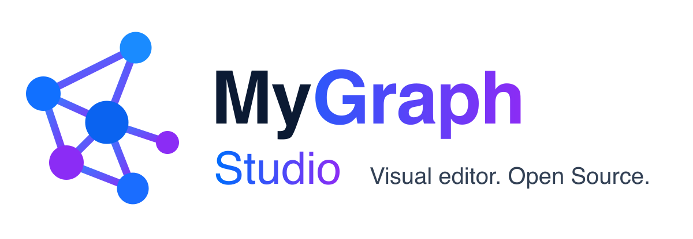

<p align="center">
  <picture>
    <source media="(prefers-color-scheme: dark)" srcset="branding/banner-dark.png">
    
  </picture>
</p>

<p align="center">
  Visual editor for <a href="https://github.com/julioacontreras/my-graph">MyGraph</a>: run Cypher and explore the result as a graph, table or JSON.
</p>

<p align="center">
  <a href="https://github.com/julioacontreras/my-graph"></a>
  <a href="gateway/pyproject.toml"></a>
  <a href="frontend/package.json"></a>
  <a href="LICENSE"></a>
</p>

<p align="center">
  <a href="#installation"><strong>Installation</strong></a> ·
  <a href="#usage"><strong>Usage</strong></a> ·
  <a href="#configuration"><strong>Configuration</strong></a> ·
  <a href="#development"><strong>Development</strong></a> ·
  <a href="docs/documentaci_n_my_graph_studio.md"><strong>Specification</strong></a>
</p>

---

MyGraph Studio lets you work with a MyGraph database from the browser. You can
run Cypher, view the result as a graph, edit nodes and relationships, define
labels with types and colors, and export or import the graph.

The browser cannot open MyGraph's TCP socket (port 6660), so the Studio has two
parts: a React frontend and a FastAPI **gateway**. The gateway translates
HTTP/JSON to the [v1 protocol](https://github.com/julioacontreras/my-graph/blob/main/PROTOCOL.md)
using [`mygraph-client`](https://pypi.org/project/mygraph-client/).

```
browser ──HTTP/JSON──▶ gateway (FastAPI, :8000) ──protocol v1──▶ mygraph-server (:6660)
```

> [!IMPORTANT]
> Requires **MyGraph 0.2** or later. MyGraph v0.2 has no authentication or
> TLS: do not expose port 6660 outside the gateway's network. The Studio has
> no login yet either.

## Contents

- [Features](#features)
- [Installation](#installation)
- [Usage](#usage)
- [Configuration](#configuration)
- [Development](#development)
- [Architecture](#architecture)
- [Limitations](#limitations)
- [License](#license)

## Features

| Module | What it does |
|---|---|
| **Cypher & Graph** | Cypher editor (CodeMirror) with errors marked by line and column. Scripts with multiple statements separated by `;`. **Graph** (D3), **Table** and **JSON** views. Inspector to edit properties and labels, delete nodes and relationships, and expand neighbors. Database and schema selector. |
| **Label Designer** | Define per label a color, a description and typed properties (`String`, `Integer`, `Float`, `Boolean`, `Date`) with the `required`, `unique` and `indexed` flags. Creates the indexes in MyGraph, lists nodes that don't comply and suggests definitions based on the data. |
| **Import / Export** | Export to JSON or to a Cypher script. Import JSON or `.cypher`/`.cql`/`.cyp` in **append** or **overwrite** mode, in batches and with a preview summary. |

## Installation

### Docker Compose (recommended)

From the repository root:

```bash
docker compose up -d --build     # MyGraph + Studio at http://localhost:8000
docker compose ps                # check that both services are running
docker compose logs -f studio    # follow the Studio logs
docker compose down              # stop everything; data stays in the volumes
docker compose down -v           # stop everything and DELETE the data
```

The `studio` service builds the frontend and serves it from the gateway, in a
single container. Data is stored in two volumes:

| Volume | Contents |
|---|---|
| `mygraph-data` | The graph (MyGraph WAL and snapshots) |
| `studio-data` | `studio.db`: Studio label definitions (SQLite) |

> [!WARNING]
> In production, remove the `ports` block from the `mygraph` service in
> [`docker-compose.yml`](docker-compose.yml). It is only needed for running the
> gateway locally.

### Against an existing MyGraph

Start only the Studio and point `MYGRAPH_HOST` / `MYGRAPH_PORT` at your server
(see [Configuration](#configuration)):

```bash
docker build -f gateway/Dockerfile -t mygraph-studio .
docker run -d -p 8000:8000 -v studio-data:/data \
  -e MYGRAPH_HOST=my-server -e MYGRAPH_PORT=6660 mygraph-studio
```

## Usage

Open http://localhost:8000.

1. Pick the database and schema at the top (default `default` / `public`).
2. Write a **Cypher** query and run it:

   ```cypher
   CREATE (a:Person {name: 'Ada'})-[:KNOWS]->(b:Person {name: 'Alan'});
   MATCH (n)-[r]->(m) RETURN n, r, m LIMIT 100
   ```

3. Click a node to edit it in the inspector or to expand its neighbors.
4. In **Labels**, define `Person` with `name: String, required, unique`. From
   then on the Studio validates the writes it makes and creates the index.
5. In **Import / Export**, download the graph as JSON or Cypher.

The gateway API is documented at http://localhost:8000/docs (OpenAPI) and in
the [specification](docs/documentaci_n_my_graph_studio.md#api-del-gateway).
To check that it responds: `curl http://localhost:8000/api/health`.

## Configuration

The gateway reads environment variables or a `gateway/.env` file (copy
[`gateway/.env.example`](gateway/.env.example)).

| Variable | Default | Description |
|---|---|---|
| `MYGRAPH_HOST` | `localhost` | `mygraph-server` host |
| `MYGRAPH_PORT` | `6660` | `mygraph-server` port |
| `MYGRAPH_TIMEOUT` | `30` | Timeout for requests to MyGraph, in seconds |
| `STUDIO_DB_PATH` | `studio.db` | SQLite file with label definitions (`/data/studio.db` in Docker) |
| `CORS_ORIGINS` | `[]` | JSON list of allowed origins. Empty in development: Vite acts as a proxy |
| `STATIC_DIR` | — | Folder with the frontend build. If it exists, the gateway serves it |

In the frontend, `GATEWAY_URL` changes the target of Vite's `/api` proxy
(default `http://localhost:8000`).

## Development

Requirements: Docker, [uv](https://docs.astral.sh/uv/) and Node 22.

```bash
docker compose up -d mygraph                        # mygraph-server at 127.0.0.1:6660

cd gateway
uv sync
uv run uvicorn mygraph_studio.main:app --reload     # http://localhost:8000

cd frontend
npm install
npm run dev                                         # http://localhost:5173, /api → gateway
```

### Tests and lint

```bash
cd gateway
uv run pytest                    # integration tests are skipped if there is no mygraph-server
uv run ruff check src tests

cd frontend
npm run typecheck
npm run build                    # typecheck + production build into dist/
```

Integration tests create a `studio_test_*` database and delete it when they
finish. To use another server: `MYGRAPH_PORT=6661 uv run pytest`.

## Architecture

```
frontend/   React 19 + Vite + TypeScript + Tailwind v4 + D3 + CodeMirror 6
  src/api/        HTTP clients for the gateway
  src/features/   cypher, graph, labels, transfer
  src/state/      session (database/schema) and label definitions

gateway/    FastAPI + mygraph-client 0.2
  src/mygraph_studio/api/        /api/v1/* routes
  src/mygraph_studio/services/   validation, import/export, graph extraction
  src/mygraph_studio/store/      SQLite store for label definitions
  src/mygraph_studio/db/         MyGraph session, serialization and errors
```

- The gateway sends Cypher to MyGraph as is. The frontend has no parser.
  MyGraph errors (`{code, message, line?, column?}`) are passed through unchanged.
- Label definitions live in the Studio, not in MyGraph. `required` and
  `unique` are checked by the gateway, so they only protect writes made from
  the Studio.
- Import/export is implemented in the gateway with Cypher, because MyGraph v0.2
  does not provide it.

Details are in the [specification](docs/documentaci_n_my_graph_studio.md).

## Limitations

These come from MyGraph v0.2:

| Limitation | Effect on the Studio |
|---|---|
| No `MERGE` | Export/import uses `MATCH` + `CREATE` and a temporary `_sid` property |
| No constraints | `required`/`unique` are validated by the gateway; "Check data" button |
| No date type | `Date` is stored as an ISO-8601 string |
| No `UNION`, `CALL`, regex `=~` | The editor shows the MyGraph error |
| No authentication or TLS | Port 6660 on the internal network only; the Studio has no login yet |
| Serialized writes | Import in short batches, with no transactions held open across requests |

## License

[MIT](LICENSE) © 2026 Julio Contreras
